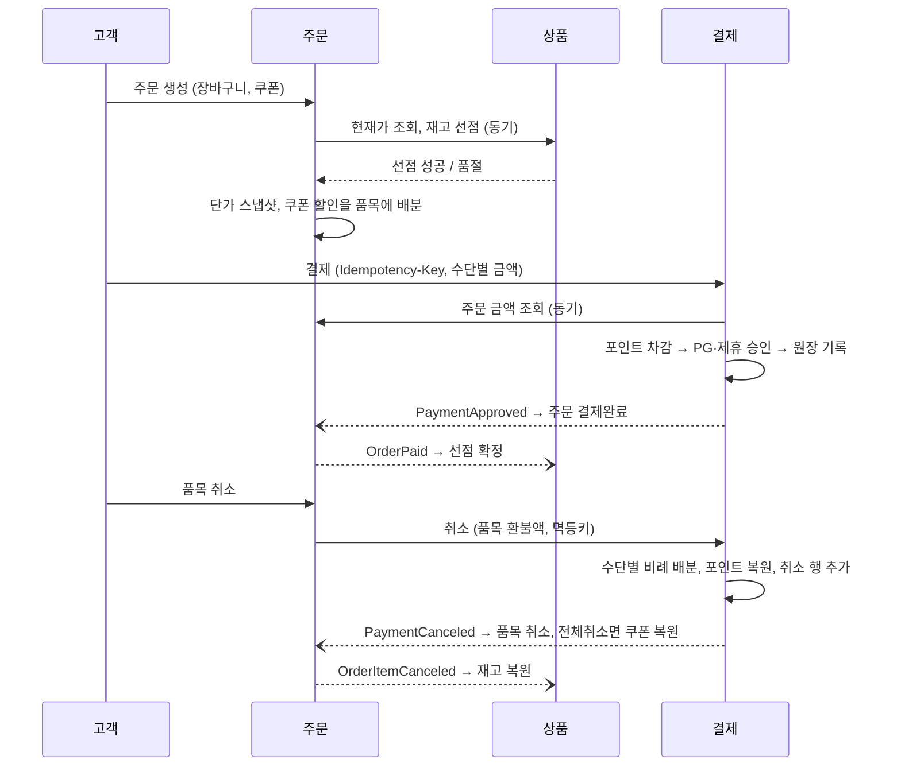

# 장바구니-주문-결제 흐름 재설계 (DESIGN)

| 요구사항 | 이 문서 | 코드 |
|---|---|---|
| 1. 장바구니 → 주문 → 결제 재설계 | 2절 | 없음 (설계) |
| 2. 레거시/신규 DB 분리와 공존 | 3절 | 없음 (설계) |
| 3. 가장 위험한 지점의 구현 | 4절 | 결제 서비스 (`./gradlew test`) |

과제 안내의 "전체를 구현할 필요는 없습니다"에 따라 코드는 요구사항 3만 작성했다. 결정별 대안과 trade-off는 `adr/`에 있다.

---

## 1. 문제 정의

`legacy_db.sql`의 시드 데이터에서 직접 확인한 결함이다. 결함을 위험 유형으로 나누고, 금액 정합성 > 동시성 > 모델링 > 위생 순서로 먼저 다룬다.

| 위험 유형 | 뜻 |
|---|---|
| 금액 | 고객이나 회사가 받거나 내야 할 금액이 틀어진다 |
| 동시성 | 요청이 동시에 몰리거나 재시도될 때 데이터가 깨진다 |
| 모델링 | 테이블 구조가 업무를 표현하지 못한다 |
| 위생 | 무결성 장치가 없어 오류를 막거나 찾지 못한다 |

| # | 위험 유형 | 지점 | 데이터 증거 | 위험 |
|---|---|---|---|---|
| F1 | 금액 | 주문·결제 상태 불일치 | `ORD20260301004`: ORD_STAT `20`(결제완료)인데 TB_PAY는 `N`, 승인번호 없음 | 미결제 주문이 결제완료로 처리됨 |
| F2 | 금액 | 복합결제 부분취소 배분 오류 | `ORD20260301005`(카드 79,000 + 포인트 7,000): 취소 35,833원 전액을 카드로 환불 | 포인트 2,917원이 현금으로 환불됨, 수단별 정산 불일치 |
| F3 | 금액 | 취소 기록 방식이 두 가지 | `ORD20260228009`는 승인 행을 `C`로 덮어씀, `ORD20260301005`는 취소 행 추가 | 원 승인 기록 소실, 감사 추적 불가 |
| F4 | 금액 | 취소 시 쿠폰 미복원 | `CPN002`가 취소 주문에 묶인 채 USE_YN `Y` | 고객 손실, 이중 사용 방지 장치 없음 |
| F5 | 모델링 | 결제수단 열 나열 | TB_PAY 한 행에 카드·가상계좌·포인트·제휴·쿠폰 열 전부 | 수단이 늘면 표현 불가, 수단별 취소 불가 |
| F6 | 동시성 | 재고가 상품 행의 숫자 하나 | TB_GOODS.STOCK_QTY, 선점 개념 없음. SALE_STAT `02`는 재고 0의 중복 표시 | 세일 오픈 시 오버셀, 품절 표시 불일치 |
| F7 | 모델링 | 가격 이력 없음 | SALE_PRC 단일 컬럼 | 장바구니 가격과 결제 가격 차이를 설명할 수 없음 |
| F8 | 동시성 | 포인트가 잔액 컬럼만 | TB_MEMBER.POINT_AMT, 사용 이력 없음 | 동시 사용 시 갱신 유실, 정정 불가 |
| F9 | 동시성 | 멱등성 부재 | 승인번호·주문당 승인 행에 UNIQUE 없음 | 네트워크 재시도가 이중 결제가 됨 |
| F10 | 위생 | 무결성 장치 없음 | FK·UNIQUE 없음, 날짜가 TEXT, 주문번호가 일자+일련번호 | 정합성 검증 불가, 동시 채번 충돌 |

---

## 2. 전체 구조 (요구사항 1)

### 2.1 서비스 3개

| 서비스 | 소유 데이터 | 역할 |
|---|---|---|
| 상품 | goods, price_history, stock(qty, reserved_qty), stock_reservation | 가격, 재고 선점·확정·해제 |
| 주문 | cart, orders, order_item(단가 스냅샷·할인 배분액), coupon | 장바구니, 주문, 쿠폰(= 주문 할인) |
| 결제 | payment_master/detail/transaction, payment_request, point_account/transaction | 복합결제, 내부 포인트(= 지불수단) |

서비스마다 배포 단위와 DB가 하나씩이다. 다른 서비스의 테이블은 읽지도 쓰지도 않는다.

### 2.2 흐름

- **동기 호출은 두 곳뿐이다.** 재고 선점(고객이 품절 여부를 즉시 알아야 함)과 결제 전 금액 조회(서버 금액만 신뢰)다.
- **나머지는 outbox 이벤트다.** DB 변경과 이벤트 기록을 한 트랜잭션에 넣고, 수신 측은 이벤트 ID로 중복을 버린다. 운영에서는 Debezium → Kafka로 전달한다.

### 2.3 과제 제약에 대한 답

| 제약 | 설계 |
|---|---|
| 동일 상품 주문 폭주 | 주문 생성 시 `qty - reserved_qty >= ?` 조건부 UPDATE로 선점. 성공 1행이면 확보, 0행이면 즉시 품절 (ADR-003) |
| 가격 수시 변경 | 장바구니는 현재가 표시, 주문 생성 시점 단가를 `order_item`에 고정. 결제는 고정된 금액만 신뢰 |
| 복합결제 | 결제를 수단별 행으로 나누고 취소도 수단별로 기록 (4절, ADR-001) |
| 서비스 무중단 | 주문 단위로 신규 비율을 올리고, 비율 0으로 즉시 되돌림 (3절, ADR-002) |

### 2.4 동시성 방어 지점

SQLite에는 `SELECT ... FOR UPDATE`가 없어 조건부 UPDATE와 UNIQUE로 막는다. 운영 DB(MySQL)에서도 같은 SQL이 행 잠금으로 동작한다.

| 지점 | 방법 | 막는 사고 | 구현 |
|---|---|---|---|
| 같은 주문 이중 승인 | `payment_master.order_no UNIQUE`, 외부 호출 전에 INSERT | 이중 결제 | O |
| 재시도 | `payment_request.idempotency_key UNIQUE` | 이중 결제 | O |
| 포인트 차감 | `balance >= ?` 조건부 UPDATE + 원장 행 | 잔액 초과, 갱신 유실 | O |
| 수단별 취소 누계 | `canceled + ? <= approved` 조건부 UPDATE + CHECK | 승인액 초과 환불 | O |
| PG 타임아웃 | 요청을 UNKNOWN으로 남기고 같은 키로 재시도 | 승인됐는데 모르는 상태 | O |
| 쿠폰 사용 | `use_yn = 'N'` 조건부 UPDATE | 이중 사용 | 설계 |
| 재고 선점 | `qty - reserved_qty >= ?` 조건부 UPDATE | 오버셀 | 설계 |

외부에 노출하는 번호(`order_no`, `payment_no`)는 시간 + 난수 문자열이다. 순번을 노출하면 주문량이 드러나고, 공존 기간에 레거시와 신규가 각자 채번하면 충돌한다.

---

## 3. 레거시 DB와 신규 DB 분리, 공존 (요구사항 2)

### 3.1 결정

| 대상 | 원천 | 방법 |
|---|---|---|
| 신규가 만든 주문 | 신규 DB | 레거시 화면용으로 TB_ORDER·TB_PAY에 동기화 행을 쓴다. 레거시 쪽 쓰기는 차단 |
| 레거시가 만든 주문 | 레거시 DB | 결제·취소까지 레거시가 끝낸다. 신규는 읽기만 |
| 공유 자원(포인트 잔액·재고·쿠폰) | 전환 완료 전까지 레거시 DB | 신규 서비스가 레거시 테이블에 조건부 UPDATE로 직접 차감·복원 |

- **분기점은 주문 생성 하나다.** 설정 `new-order-ratio`만큼 새 주문을 신규로 보낸다. 0으로 내리면 새 유입이 멈추고, 이미 신규에서 시작한 주문은 신규가 끝까지 처리한다.
- **공유 자원은 주문 단위로 나눌 수 없다.** 원천이 둘이면 레거시 주문과 신규 주문이 같은 포인트를 두 번 쓰거나 같은 재고를 두 번 판다. 그래서 전환이 끝날 때까지 레거시를 정답으로 두고, 마지막에 한 번 이관한다.
- **레거시 코드는 고치지 않는다.** 설계 문서와 개발자가 없으므로, 레거시 화면이 이해하는 기존 코드값(ORD_STAT `20`/`90`, PAY_STAT `Y`/`N`/`C`)으로만 동기화 행을 쓴다.

### 3.2 근거

| 버린 안 | 이유 |
|---|---|
| 일괄 전환 | 점검 시간이 필요하다. 서비스는 멈출 수 없다 |
| 애플리케이션 이중 쓰기 | 두 DB를 한 트랜잭션으로 묶을 수 없어 한쪽만 성공하는 상태가 생기고, 쓰기 지연이 늘어난다 |
| 레거시 원천 + 신규 섀도우 후 교체 | 검증된 방식이지만 신규가 원천이 되는 시점이 늦고, 둘을 맞추는 보정 배치가 따로 필요하다 |
| 공유 자원을 처음부터 신규 원천으로 | 레거시 코드가 신규 API를 호출하도록 고쳐야 한다 |

주문 단위 라우팅은 처음 1% 주문부터 신규가 원천이라 운영 데이터로 바로 검증되고, 비율 하나로 되돌릴 수 있다.

### 3.3 전환 단계

| 단계 | 핵심 변화 | 주문 원천 | 공유 자원 원천 | 롤백 | 다음 단계 조건 |
|---|---|---|---|---|---|
| 0. 전환 전 | 레거시가 전부 처리 | 레거시 | 레거시 | 없음 | 신규 설계 완료 |
| 1. 준비 | 신규 서비스·DB·동기화 경로 배포, 비율 0. 레거시 데이터로 읽기 결과 비교 | 레거시 | 레거시 | 배포 제거 | 읽기 비교 불일치 0 |
| 2. 부분 전환 | 비율 1% → 50%. 신규 주문은 동기화 행을 레거시에 씀. 병행 비교·대사 | 주문별로 갈림 | 레거시 | 비율 0 | 불일치 0, 대사 차이 0 |
| 3. 전량 전환 | 비율 100%. 레거시는 진행 중 주문만 마무리 | 신규 | 레거시 | 비율 낮춤 | 레거시 진행 중 주문 소진(가상계좌 입금 기한 포함) |
| 4. 원천 교체 | 포인트·재고·쿠폰을 신규로 이관, 레거시 쓰기 중단, 레거시 주문 생성 차단 | 신규 | 신규 | 이관 전 스냅샷 복원 후 3단계 | 이관 전후 합계 일치 |
| 5. 레거시 제거 | 동기화 종료, 레거시 화면을 신규 API로 교체, 레거시 DB 읽기 전용 보관 후 폐기 | 신규 | 신규 | 없음 | 레거시 조회 0 |

단계가 다섯인 이유는 두 가지를 따로 옮기기 때문이다. 주문 흐름은 비율로 조금씩 옮기고(2~3단계), 나눌 수 없는 공유 자원은 레거시 주문이 모두 끝난 뒤 한 번에 옮긴다(4단계).

---

## 4. 가장 위험한 지점: 복합결제 원장과 부분취소 (요구사항 3)

### 4.1 선택 이유

| 후보 | 금전 손실 | 되돌리기 | 레거시 증거 | SQLite·PG 없는 환경에서 증명 |
|---|---|---|---|---|
| **복합결제 원장·부분취소** | 금액이 직접 틀어짐 | 환불이 나간 뒤 회수 어려움 | F2·F3·F5 | 쉬움. 순수 로직 |
| 재고 선점·오버셀 | 큼 | 주문 취소로 되돌림 | 직접 증거 없음 | 어려움. SQLite는 쓰기가 하나씩만 |
| 주문·결제 상태 불일치 | 미결제 주문 처리 | 대사로 정정 | F1 | 보통. PG 모킹 비중 큼 |

시드 데이터에 결함이 직접 남아 있고, 과제 배경이 "하나의 결제에 PG·제휴 포인트·내부 포인트·쿠폰"을 명시한다. 멱등성(F9)도 같은 코드로 함께 증명한다.

### 4.2 구조

| 테이블 | 역할 | 변경 |
|---|---|---|
| `payment_request` | 승인·취소 요청 1건. 멱등키 UNIQUE, 상태 REQUESTED → UNKNOWN → DONE/FAILED | 요청 상태만 |
| `payment_master` | 주문 1건의 결제 (주문금액, 할인, 결제금액, 상태) | 상태만 |
| `payment_detail` | 수단별 승인분 (PG / 내부 포인트 / 제휴 포인트, 승인액, 취소 누계) | 취소 누계만 |
| `payment_transaction` | 원장. 승인·취소 1건당 1행 | 추가만 |
| `point_account` / `point_transaction` | 포인트 잔액 / 포인트 원장 | 잔액 조건부 UPDATE / 추가만 |

쿠폰은 결제수단이 아니라 할인액으로만 들어온다. 레거시의 DC_AMT = CPN_AMT 의미를 그대로 잇는다.

### 4.3 규칙

- **승인 순서**: 결제 행 INSERT → 내부 포인트 차감 → PG·제휴 승인. 중복 주문과 포인트 부족은 외부 호출 전에 걸러지므로 취소할 수 없는 PG 승인이 남지 않는다.
- **멱등성**: 같은 키 재요청은 저장된 응답을 그대로 돌려준다. 같은 키로 다른 본문, 다른 요청 종류, 다른 결제를 보내면 422다. PG·제휴사에는 수단마다 다른 키를 보낸다.
- **타임아웃**: 기록을 롤백하고 요청만 UNKNOWN(202)으로 남긴다. 같은 키로 재시도하면 PG도 같은 결과를 돌려주므로 이어서 기록된다. 동시에 여러 번 재시도해도 조건부 UPDATE로 한 요청만 재실행한다.
- **부분취소**: 취소 금액을 수단별 남은 금액 비율로 나누고, 1원 단위 잔차는 소수부가 큰 수단부터 준다(최대잔여법). 합계가 항상 취소 금액과 같다.
- **취소 기록**: 승인 행을 고치지 않고 취소 행을 추가한다. 수단별 취소 누계는 승인액을 넘을 수 없다.

레거시 사례 검산: 35,833 × 79,000/86,000 = 32,916.36, × 7,000/86,000 = 2,916.64 → **카드 32,916 + 포인트 2,917**. 레거시는 35,833 전부를 카드로 환불했다.

### 4.4 테스트

| 테스트 | 검증 | 결함 |
|---|---|---|
| 복합 승인: PG + 포인트 + 마일리지 | 수단별 detail·원장 행, 포인트 차감, outbox 행 | F5, F8 |
| 멱등: 같은 키 두 번이면 같은 응답, 부수효과 없음 | 응답 동일, 원장·PG 승인 수 불변, 다른 본문 422 | F9 |
| 35,833 부분취소: 잔액 비율 배분 + 포인트 복원 | 카드 32,916 / 포인트 2,917, 포인트 +2,917 | F2 |
| 환불 누계는 승인액을 넘지 못한다 | 초과 취소 422, 전액 취소 후 1원도 거절 | F2, F3 |
| 거절 경로 | 금액 불일치·포인트 부족·주문 없음 422, 결제 없음 404, 키 없음 400 | F1 일부 |
| 외부 승인 전에 포인트를 먼저 차감한다 | 포인트 부족이면 PG 호출 0건 | F1 일부 |
| 같은 주문의 두 번째 승인은 PG 호출 전에 거절 | PG 승인 수 불변 | F9 |
| PG와 제휴 포인트가 같은 제휴사여도 각각 승인된다 | 게이트웨이 멱등키가 수단별로 달라 승인 2건 | F9 |
| provider에 구분자가 들어오면 PG 호출 없이 거절 | 게이트웨이 키가 다른 요청과 겹치지 않음 | F9 |
| 같은 멱등키를 다른 결제의 취소에 쓰면 거절 | 다른 결제에 저장된 응답을 재생하지 않음 | F9 |
| 동시 전체취소: 하나만 성공 | 두 요청 중 1건만 200, 취소 합계 = 결제 금액 | F3 |
| UNKNOWN 요청을 같은 키로 동시에 재시도해도 한 번만 처리 | 재실행은 한 요청만, 나머지는 409 또는 저장된 응답 | F9 |
| PG 타임아웃(APPROVED_BUT_LOST / NOT_RECORDED) | 202 UNKNOWN 후 같은 키로 200, 승인·포인트 차감 각 1번 | F9 |
| `MoneyAllocateTest` (5개) | 배분 합계 불변식(무작위 1,000건), 35,833 사례 | F2 |

코드에 없는 것: 주문·상품 서비스, 레거시 DB와 동기화, outbox 전달, 실제 PG(인메모리 게이트웨이로 대체). 결제 서비스는 point_account를 원천으로 둔 4단계 이후 모습이다.

---

## 5. 세운 가정

| # | 가정 | 틀리면 바뀌는 것 |
|---|---|---|
| A1 | 레거시의 재고 차감 시점은 알 수 없다. 신규는 주문 시 선점, 결제 완료 시 확정, 취소·실패·가상계좌 만료 시 해제 | 결제 시 차감이 맞다면 선점이 빠지고 "결제 중 품절" 응답이 생긴다 |
| A2 | 쿠폰 최소 결제금액 조건은 없다(레거시에 컬럼 없음) | 부분취소 후 최소금액 미달 시 거절 규칙이 추가된다 |
| A3 | 쿠폰 복원은 전체취소에서만. 부분취소는 할인액을 품목 비례로 차감 | 주문 서비스의 취소 처리만 바뀐다 |
| A4 | 레거시의 취소 기록 혼재(F3)는 버그다 | 의도였다 해도 동기화 행만 그 형식을 따르고 신규 원장은 유지 |
| A5 | PG·제휴사는 멱등키를 지원한다 | 미지원 PG는 승인 조회 API로 UNKNOWN을 해소하는 분기가 추가된다 |
| A6 | 취소 금액(품목 환불액)은 주문 서비스가 계산해 보낸다 | 결제에 품목별 배분 테이블이 추가된다 |
| A7 | 제휴 포인트는 외부 승인·취소가 필요한 수단이다 | 내부 정산이면 내부 포인트와 같은 경로로 합쳐진다 |
| A8 | 레거시 화면은 기존 코드값만 이해한다 | 화면을 고칠 수 있다면 동기화 행에 부분취소 상태를 추가한다 |
| A9 | 주문 시 가격이 장바구니와 달라도 주문을 막지 않는다(응답에 "가격 변경됨") | 막아야 한다면 장바구니 재확인 단계가 추가된다 |
| A10 | 공존 기간 공유 자원은 레거시가 원천이고 신규가 조건부 UPDATE로 직접 차감한다 | 신규가 원천이면 레거시 코드가 신규 API를 호출하도록 고쳐야 한다 |
| A11 | 인증은 앞단 API 게이트웨이가 맡고, 결제 서비스는 인증된 호출만 받는다. 결제 서비스는 이 과제 범위에서 호출자를 검사하지 않는다 | 운영에서는 게이트웨이가 넘긴 회원 ID와 결제의 회원 ID를 조회·취소 때마다 대조하는 소유권 검사를 추가한다 |
